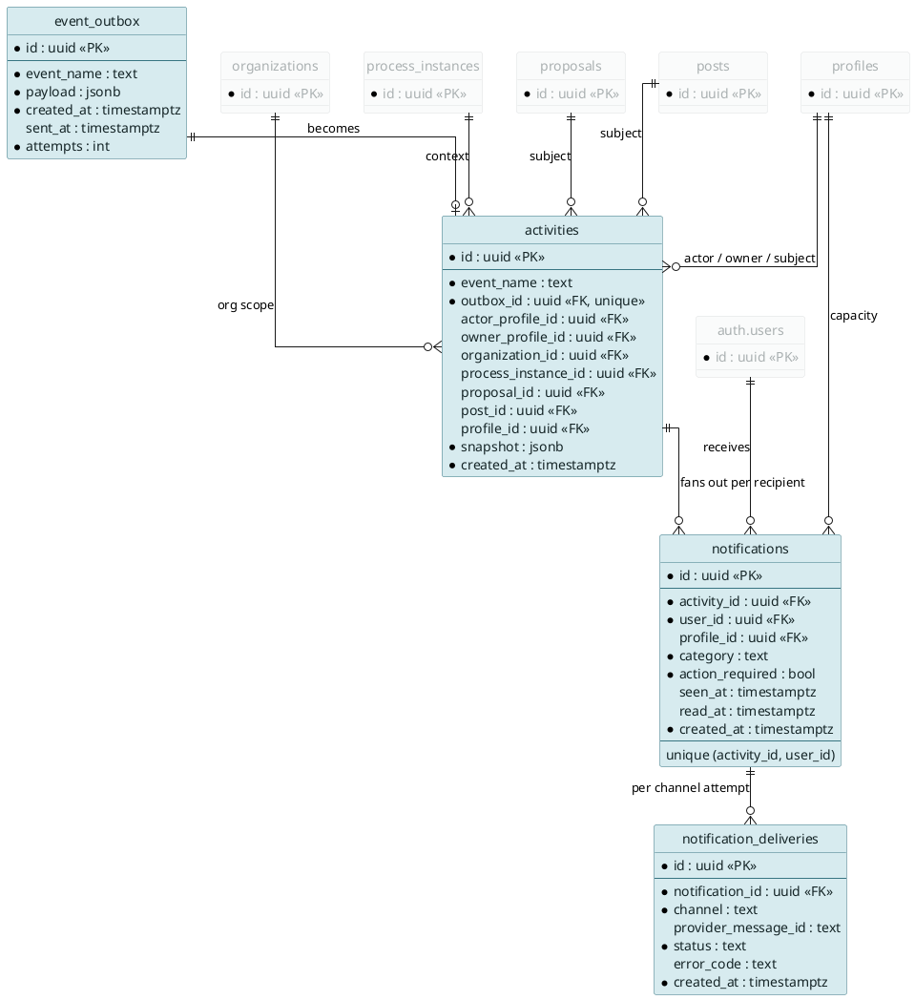
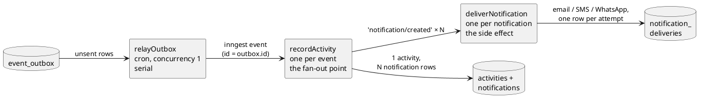
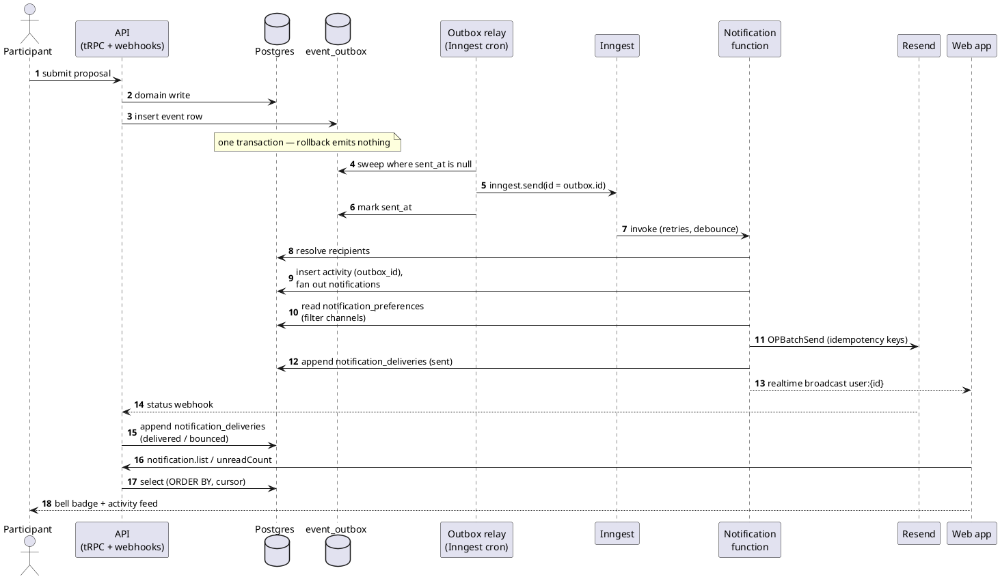
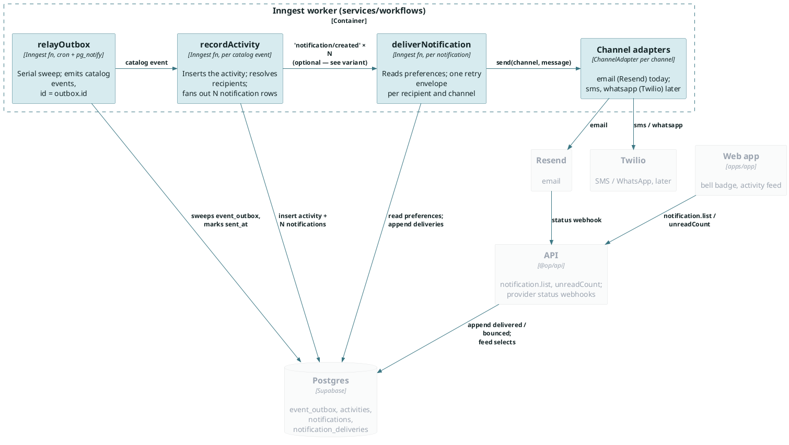
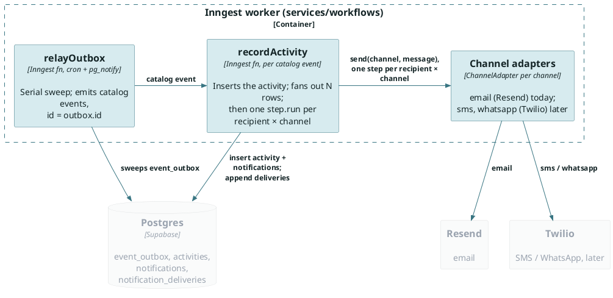
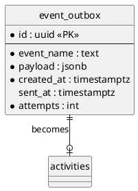
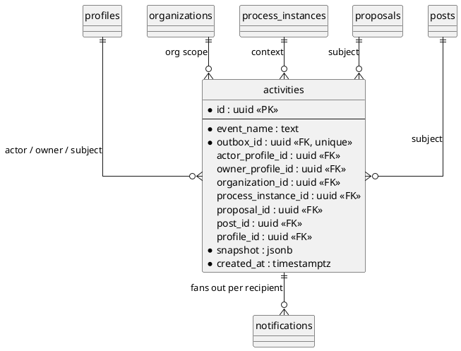
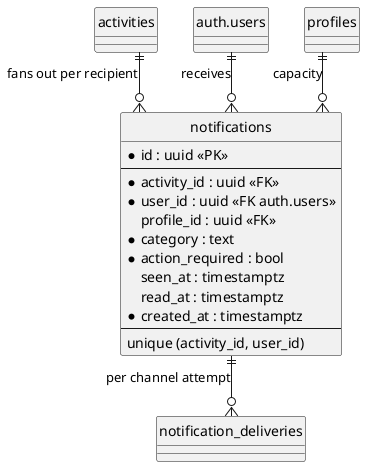
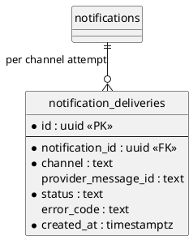

# Notifications Goals

ADR PR: [docs(adr): store notifications as outbox, activity, and per-recipient rows (#2532)](https://github.com/oneprojectorg/common/pull/2532)

- We want to design a single storage schema for notifications that can power an activity feed and email notifications
- We want this to be as transactional as possible
  - Retries
  - Activity feed record
  - No state in the inngest system, functions can crash and restart
  - Soft At-least-once delivery; duplicates are deduped by the `outbox_id` and `(activity_id, user_id)` uniques

- We want to be able to quickly query for activity feeds

# Overview

<style>
.columns { display: flex; gap: 2rem; align-items: flex-start; }
.columns .column { min-width: 0; }
</style>

:::: {.columns}

::: {.column style="flex: 0 0 42%"}

| Table Name | Holds |
| --- | --- |
| `event_outbox` | the event, written in the domain transaction |
| `activities` | one feed row per event, scoped by ids |
| `notifications` | one row per recipient, with read state |
| `notification_deliveries` | one row per channel attempt |

## Feed for a person

```sql
select n.id, n.category, n.seen_at, n.read_at,
       a.event_name, a.snapshot, a.created_at
from notifications n
join activities a on a.id = n.activity_id
where n.user_id = $1
  and (n.created_at, n.id) < ($2, $3)
order by n.created_at desc, n.id desc
limit 20;
```

```json
{
  "$1": "d4c3b2a1-f6e5-4b7a-9d8c-5f4e3d2c1b0a",
  "$2": "2026-11-12T14:03:22.418Z",
  "$3": "11aa22bb-33cc-4dd4-8ee5-ff6677889900"
}
```

## Feed for an organization

```sql
select a.id, a.event_name,
       a.actor_profile_id, a.snapshot, a.created_at
from activities a
where a.organization_id = $1
  and (a.created_at, a.id) < ($2, $3)
order by a.created_at desc, a.id desc
limit 20;
```

```json
{
  "$1": "2b3c4d5e-6f70-4a81-92b3-c4d5e6f70819",
  "$2": "2026-11-12T14:03:22.418Z",
  "$3": "7c9e1d2a-4f3b-4a8e-9c01-5b6d7e8f9a01"
}
```

## Feed for an decision process

```sql
select a.id, a.event_name,
       a.actor_profile_id, a.snapshot, a.created_at
from activities a
where a.process_instance_id = $1
  and (a.created_at, a.id) < ($2, $3)
order by a.created_at desc, a.id desc
limit 20;
```

```json
{
  "$1": "9e8d7c6b-5a49-4382-b716-05f4e3d2c1b0",
  "$2": "2026-11-12T14:03:22.418Z",
  "$3": "7c9e1d2a-4f3b-4a8e-9c01-5b6d7e8f9a01"
}
```

:::

::: {.column style="flex: 1 1 58%"}



:::

::::


# Inngest functions



- Each stage is idempotent on its own key: `outbox_id`, `(activity_id, user_id)`, the provider idempotency key
- A retry at any stage re-does only that stage — it never re-fans or re-sends what already landed

# Send Sequence Diagram




# C3 — components of the Inngest worker



# C3 variant — without the internal event



- No `notification/created` event: fan-out and delivery are one function run, two functions total
- Retry isolation comes from step granularity — a failed send resumes at its own `step.run`, finished sends never re-run
- The trade: a large audience is one long run (Inngest caps steps per run); the event version spreads it across runs and gives each recipient its own retry budget
- Start here; add the event when an audience outgrows a single run

# Existing events that become activities

| Event | Feed scope | Recipients → category | action_required |
| --- | --- | --- | --- |
| `proposal/submitted` | process, org | admins → `processUpdates`, followers → `thingsYouFollow` | no |
| `proposalComment/posted` | proposal | author + participants → `proposalsAndComments` | no |
| `comment/posted` | post, org | post author → `proposalsAndComments` | no |
| `post/reaction-added` | post | post author → `proposalsAndComments` | no |
| `review/revision-requested` | proposal | author → `proposalsAndComments` | **yes** |
| `review/proposal-revision-submitted` | proposal | reviewers → `processUpdates` | **yes** |
| `decision/phase-transitioned` | process, org | members → `processUpdates` | no |
| `decision/update-posted` | process, org | members → `processUpdates` | no |
| `decision/results-notified` | process, org | members → `processUpdates` | no |
| `proposal/merged`, `proposal/rejected` | proposal | author → `proposalsAndComments` | no |

# event_outbox



# event_outbox — PostgreSQL

```sql
create table event_outbox (
  id          uuid primary key default gen_random_uuid(),
  event_name  text not null,      -- 'proposal/submitted', from the Events catalog
  payload     jsonb not null default '{}',  -- ids only
  created_at  timestamptz not null default now(),
  sent_at     timestamptz,
  attempts    int not null default 0
);

-- the relay sweeps this: unsent rows, oldest first
create index on event_outbox (created_at) where sent_at is null;
```

- Written in the **same transaction** as the domain write: rollback emits nothing
- A relay (Inngest cron, pg_notify as optional wake-up) delivers at least once, `id` doubles as the Inngest event id
- One sweep at a time (Inngest concurrency 1); an overlapping or crashed sweep can only re-send, never lose — the `outbox_id` unique on `activities` absorbs the duplicate
- Sent rows are pruned after 30 days; the partial index keeps the sweep fast regardless

# event_outbox — writing with the domain model

```sql
-- submitting a proposal: domain write and event in one transaction
begin;

update proposals
   set status = 'submitted', submitted_at = now()
 where id = $1;

insert into event_outbox (event_name, payload)
values ('proposal/submitted',
        jsonb_build_object(
          'proposalId',        $1,
          'processInstanceId', $2,
          'actorProfileId',    $3));

commit;  -- rollback emits nothing
```

- The service never calls `inngest.send` — the relay owns delivery, so a crash after commit loses nothing
- `payload` carries ids only; the notification function re-reads the rows at delivery time and builds `snapshot` then

# event_outbox — other domain writes

```sql
-- post/reaction-added, in addReaction's transaction
insert into post_reactions (post_id, profile_id, reaction_type)
values ($1, $2, $3);

insert into event_outbox (event_name, payload)
values ('post/reaction-added',
        jsonb_build_object('postId', $1, 'actorProfileId', $2));

-- decision/joined, in the voter enrolment's transaction
insert into decision_voter_enrolments (process_instance_id, profile_id)
values ($1, $2);

insert into event_outbox (event_name, payload)
values ('decision/joined',  -- new event, see below
        jsonb_build_object('processInstanceId', $1, 'actorProfileId', $2));
```

- One pattern everywhere: domain write and outbox insert in one transaction, nothing else
- The event name and payload shape come from the Events catalog (`services/events/src/types.ts`), so the relay and the notification function parse with the same Zod schema

# activities



# activities — PostgreSQL

```sql
create table activities (
  id                   uuid primary key default gen_random_uuid(),
  event_name           text not null,
  outbox_id            uuid not null references event_outbox(id),  -- also the Inngest event id
  actor_profile_id     uuid references profiles(id),
  owner_profile_id     uuid references profiles(id),      -- denormalized owning scope
  organization_id      uuid references organizations(id), -- denormalized org scope
  process_instance_id  uuid references process_instances(id),
  proposal_id          uuid references proposals(id),
  post_id              uuid references posts(id),
  profile_id           uuid references profiles(id),
  snapshot             jsonb not null default '{}',
  created_at           timestamptz not null default now(),
  check (num_nonnulls(process_instance_id, proposal_id,
                      post_id, profile_id) > 0)
);

-- one composite index per feed scope: (scope, created_at desc, id desc),
-- the same shape posts_to_organizations uses for its org feed
-- idempotency backstop: a replayed event cannot record twice
create unique index on activities (outbox_id);

create index on activities (process_instance_id, created_at desc, id desc);
create index on activities (owner_profile_id,    created_at desc, id desc);
create index on activities (organization_id,     created_at desc, id desc);
create index on activities (actor_profile_id,    created_at desc, id desc);
```

# activities — example row

```sql
select jsonb_pretty(to_jsonb(a)) from activities a
 where a.event_name = 'proposal/submitted' limit 1;
```

```json
{
  "id": "7c9e1d2a-4f3b-4a8e-9c01-5b6d7e8f9a01",
  "event_name": "proposal/submitted",
  "outbox_id": "0b1c2d3e-4f5a-4b6c-8d7e-9f0a1b2c3d4e",
  "actor_profile_id": "a1b2c3d4-e5f6-4a7b-8c9d-0e1f2a3b4c5d",
  "owner_profile_id": "c0ffee00-1234-4abc-9def-567890abcdef",
  "organization_id": "2b3c4d5e-6f70-4a81-92b3-c4d5e6f70819",
  "process_instance_id": "9e8d7c6b-5a49-4382-b716-05f4e3d2c1b0",
  "proposal_id": "5e4d3c2b-1a09-4f8e-7d6c-5b4a39281706",
  "post_id": null,
  "profile_id": null,
  "snapshot": {
    "proposalName": "Shade trees for Linden",
    "processName": "Columbus Participatory Budget"
  },
  "created_at": "2026-11-12T14:03:22.418Z"
}
```

- The ids place the row in every feed scope
- `snapshot` holds only the subject names, so a feed entry survives its subject's deletion
- The actor is never snapshotted: the feed joins `actor_profile_id` to `profiles` at read time, so a renamed profile shows its current name and avatar

# Open question: deleted actors

- We join the actor at read time, so a hard-deleted profile leaves the feed entry with no name
- Decide the `on delete` rule for `actor_profile_id` and what the feed renders then — "A deleted account", or hide the row

# notifications



# notifications — PostgreSQL

```sql
create table notifications (
  id           uuid primary key default gen_random_uuid(),
  activity_id  uuid not null references activities(id) on delete cascade,
  user_id      uuid not null references auth.users(id),
  profile_id   uuid references profiles(id),
  category         text not null,
  action_required  boolean not null default false,  -- stamped from event_name at fan-out
  seen_at      timestamptz,
  read_at      timestamptz,
  created_at   timestamptz not null default now(),
  unique (activity_id, user_id)
);

create index on notifications (user_id, created_at desc, id desc);
create index on notifications (user_id) where read_at is null;
-- the "Needs action" tab
create index on notifications (user_id, created_at desc, id desc)
  where action_required and read_at is null;
```

- `seen_at`: the user opened the bell — clears the badge for everything listed
- `read_at`: the user opened this item — removes it from unread and "Needs action"

# notifications — example rows

```sql
select jsonb_pretty(to_jsonb(n)) from notifications n
 where n.activity_id = '7c9e1d2a-4f3b-4a8e-9c01-5b6d7e8f9a01';
```

```json
{
  "id": "11aa22bb-33cc-4dd4-8ee5-ff6677889900",
  "activity_id": "7c9e1d2a-4f3b-4a8e-9c01-5b6d7e8f9a01",
  "user_id": "d4c3b2a1-f6e5-4b7a-9d8c-5f4e3d2c1b0a",
  "profile_id": "c0ffee00-1234-4abc-9def-567890abcdef",
  "category": "processUpdates",
  "action_required": false,
  "seen_at": null,
  "read_at": null,
  "created_at": "2026-11-12T14:03:23.002Z"
}
```

```json
{
  "id": "99ff88ee-77dd-4cc6-8bb5-aa4433221100",
  "activity_id": "7c9e1d2a-4f3b-4a8e-9c01-5b6d7e8f9a01",
  "user_id": "e5d4c3b2-a1f0-4e9d-8c7b-6a5f4e3d2c1b",
  "profile_id": "f0e1d2c3-b4a5-4968-8776-655443322110",
  "category": "thingsYouFollow",
  "action_required": false,
  "seen_at": null,
  "read_at": null,
  "created_at": "2026-11-12T14:03:23.002Z"
}
```

- One activity, one row per recipient: the process admin lands in `processUpdates`, a follower of the proposal's author in `thingsYouFollow` — the categories already defined on `users.notificationPreferences`
- `action_required` stays false: a submission is FYI; a review assignment would stamp true

# notification_deliveries



# notification_deliveries — PostgreSQL

```sql
create table notification_deliveries (
  id                   uuid primary key default gen_random_uuid(),
  notification_id      uuid not null references notifications(id)
                            on delete cascade,
  channel              text not null,
  provider_message_id  text,
  status               text not null,
  error_code           text,
  created_at           timestamptz not null default now()
);

create index on notification_deliveries (provider_message_id);
```

# Feed for a person — your updates

```sql
-- the rows fanned out to you, with read state
select n.id, n.category, n.seen_at, n.read_at,
       a.event_name, a.snapshot, a.created_at
from notifications n
join activities a on a.id = n.activity_id
where n.user_id = $1
  and (n.created_at, n.id) < ($2, $3)        -- cursor from the previous page
order by n.created_at desc, n.id desc        -- walks (user_id, created_at, id)
limit 20;
```

```json
[
  {
    "id": "11aa22bb-33cc-4dd4-8ee5-ff6677889900",
    "category": "processUpdates",
    "seen_at": null,
    "read_at": null,
    "event_name": "proposal/submitted",
    "snapshot": {
      "proposalName": "Shade trees for Linden",
      "processName": "Columbus Participatory Budget"
    },
    "created_at": "2026-11-12T14:03:22.418Z"
  },
  {
    "id": "44dd55ee-66ff-4aa7-8bb9-cc0011223344",
    "category": "proposalsAndComments",
    "seen_at": "2026-11-11T09:15:00.000Z",
    "read_at": "2026-11-11T09:16:40.311Z",
    "event_name": "post/reaction-added",
    "snapshot": {
      "postPreview": "We should plant shade trees along…"
    },
    "created_at": "2026-11-10T18:44:09.127Z"
  }
]
```

# Feed for a person — the bell badge

```sql
select count(*) from notifications
where user_id = $1 and read_at is null;      -- partial index
```

```json
{ "count": 1 }
```

- The unread `proposal/submitted` row counts; the read reaction does not

# Feed for a person — "Needs action"

```sql
select n.id, a.event_name, a.snapshot, n.created_at
from notifications n
join activities a on a.id = n.activity_id
where n.user_id = $1 and n.action_required and n.read_at is null
order by n.created_at desc, n.id desc
limit 20;
```

```json
[
  {
    "id": "77ab88cd-99ef-4a01-8b23-c45d67e89f0a",
    "event_name": "review/revision-requested",
    "snapshot": {
      "proposalName": "Shade trees for Linden",
      "reason": "Add a cost estimate"
    },
    "created_at": "2026-11-12T16:20:05.550Z"
  }
]
```

- The revision request is the `action_required` row — stamped at fan-out from its event name

# Feed for a decision process

```sql
-- shared feed: no per-user rows, the audience is "who can see the process"
select a.id, a.event_name, a.actor_profile_id, a.snapshot, a.created_at
from activities a
where a.process_instance_id = $1
  and (a.created_at, a.id) < ($2, $3)
order by a.created_at desc, a.id desc        -- walks (process_instance_id, …)
limit 20;
```

```json
[
  {
    "id": "7c9e1d2a-4f3b-4a8e-9c01-5b6d7e8f9a01",
    "event_name": "proposal/submitted",
    "actor_profile_id": "a1b2c3d4-e5f6-4a7b-8c9d-0e1f2a3b4c5d",
    "snapshot": {
      "proposalName": "Shade trees for Linden",
      "processName": "Columbus Participatory Budget"
    },
    "created_at": "2026-11-12T14:03:22.418Z"
  },
  {
    "id": "3a2b1c0d-9e8f-4765-8432-10fedcba9876",
    "event_name": "decision/joined",
    "actor_profile_id": "f0e1d2c3-b4a5-4968-8776-655443322110",
    "snapshot": {
      "processName": "Columbus Participatory Budget"
    },
    "created_at": "2026-11-12T11:48:51.730Z"
  }
]
```

- The same `proposal/submitted` activity the person's feed showed — one row serves every scope
- The reader resolves each `actor_profile_id` to the current profile name at render time

# Feed for an organization

```sql
-- everything that happened under the org, across its processes and posts
select a.id, a.event_name, a.actor_profile_id, a.snapshot, a.created_at
from activities a
where a.organization_id = $1
  and (a.created_at, a.id) < ($2, $3)
order by a.created_at desc, a.id desc        -- walks (organization_id, …)
limit 20;
```

```json
[
  {
    "id": "7c9e1d2a-4f3b-4a8e-9c01-5b6d7e8f9a01",
    "event_name": "proposal/submitted",
    "actor_profile_id": "a1b2c3d4-e5f6-4a7b-8c9d-0e1f2a3b4c5d",
    "snapshot": {
      "proposalName": "Shade trees for Linden",
      "processName": "Columbus Participatory Budget"
    },
    "created_at": "2026-11-12T14:03:22.418Z"
  },
  {
    "id": "8d7c6b5a-4938-4271-a605-f4e3d2c1b0a9",
    "event_name": "post/reaction-added",
    "actor_profile_id": "d2c3b4a5-e6f7-4089-9a1b-2c3d4e5f6071",
    "snapshot": {
      "postPreview": "We should plant shade trees along…"
    },
    "created_at": "2026-11-10T18:44:09.127Z"
  }
]
```

- The org feed mixes event types: the process rows and the post rows share one query because both carry `organization_id`

# New events for the activity feed

The prototype's "Your activity" verbs need three events that do not exist yet:

```ts
// services/events/src/types.ts — additions to the Events catalog
proposalFollowed: {
  name: 'proposal/followed' as const,
  schema: z.object({
    proposalId: z.string().uuid(),
    actorProfileId: z.string().uuid(),
  }),
},
profileFollowed: {
  name: 'profile/followed' as const,
  schema: z.object({
    profileId: z.string().uuid(),
    actorProfileId: z.string().uuid(),
  }),
},
processJoined: {
  name: 'decision/joined' as const,
  schema: z.object({
    processInstanceId: z.string().uuid(),
    actorProfileId: z.string().uuid(),
  }),
},
```

- Already covered: "liked" → `post/reaction-added`, "submitted" → `proposal/submitted`
- These three put real events behind `thingsYouFollow`, the preference category that exists with nothing feeding it
- `action_required` is stamped from `event_name` at fan-out: review assignments and revision requests set it, FYI events do not


# 1. relayOutbox — serial

```ts
export const relayOutbox = inngest.createFunction(
  { id: 'relayOutbox', concurrency: [{ limit: 1 }] },
  { cron: '* * * * *' }, // pg_notify as optional wake-up
  async ({ step }) => {
    const rows = await step.run('sweep', () => unsentOutboxRows(100));

    for (const row of rows) {
      await step.sendEvent(`send-${row.id}`, {
        name: row.eventName,      // 'proposal/submitted'
        id: row.id,               // outbox id = Inngest event id
        data: row.payload,
      });
      await step.run(`mark-${row.id}`, () => markSent(row.id));
    }
  },
);
```

- Serial on purpose: one sweep at a time, oldest first — ordering comes free
- A crash between send and mark re-sends; the Inngest event id and the `outbox_id` unique absorb it

# 2. recordActivity — the fan-out point

```ts
export const recordActivity = inngest.createFunction(
  { id: 'recordActivity' },
  [{ event: 'proposal/submitted' },
   { event: 'post/reaction-added' },
   { event: 'decision/joined' }],
  async ({ event, step }) => {
    const activity = await step.run('record', () =>
      insertActivity(event));           // outbox_id unique absorbs replays

    const recipients = await step.run('resolve', () =>
      resolveRecipients(activity));     // admins, followers, assignees

    const notifications = await step.run('fan-out', () =>
      insertNotifications(activity, recipients)); // (activity_id, user_id) unique

    await step.sendEvent('deliver',
      notifications.map((n) => ({
        name: 'notification/created',   // new internal event
        data: { notificationId: n.id },
      })));
  },
);
```

- One activity in, N notification rows out — this is the only function that fans out
- Category and `action_required` are stamped here, from the event name

# 3. deliverNotification — the side effect

```ts
export const deliverNotification = inngest.createFunction(
  { id: 'deliverNotification', retries: 3 },
  { event: 'notification/created' },
  async ({ event, step }) => {
    const { notification, channels } = await step.run('preferences', () =>
      resolveChannels(event.data.notificationId)); // users.notificationPreferences

    for (const channel of channels) {  // email today; sms, whatsapp later
      await step.run(`send-${channel}`, () =>
        sendVia(channel, notification)); // idempotency key: notification.id + channel
      await step.run(`record-${channel}`, () =>
        insertDelivery(notification.id, channel, 'sent'));
    }
  },
);
```

- Retries are scoped to one recipient and one channel: a bounced address never re-sends anyone else's email
- Each attempt appends a `notification_deliveries` row; the provider webhook appends the outcome

# Channel adapters — one interface

```ts
interface ChannelAdapter {
  channel: 'email' | 'sms' | 'whatsapp';
  send(message: OutboundMessage): Promise<{ providerMessageId: string }>;
}

// the moderation-provider pattern: null means the channel is off, not broken
const adapters: Record<NotificationChannel, ChannelAdapter | null> = {
  email: getResendAdapter(),
  sms: getTwilioAdapter(),        // later
  whatsapp: getWhatsAppAdapter(), // later
};
```

- `deliverNotification` selects channels from the preferences and calls `send` — it never sees provider details
- Email is not special: one more channel behind the same interface, one `channel` value per deliveries row
- Adding WhatsApp is one adapter plus one preference channel; the function, the event, and the table do not change
- If email batching ever matters, it lives inside the Resend adapter, invisible to the function

# One event, end to end

| Stage | Rows | Example |
| --- | --- | --- |
| Amara submits a proposal | 1 `event_outbox` row | `proposal/submitted`, ids-only payload |
| relayOutbox | 1 Inngest event | id = the outbox id |
| recordActivity | 1 `activities` + 2 `notifications` | the admin (`processUpdates`), a follower (`thingsYouFollow`) |
| deliverNotification × 2 | 1 `notification_deliveries` row | the admin gets the email; the follower has email off, so in-app only |
